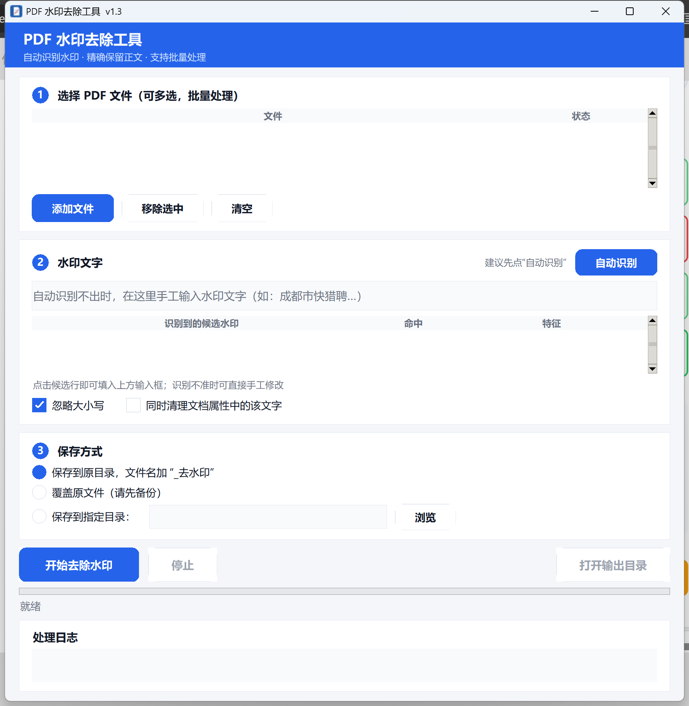

# PDF 水印去除工具

一个 Windows 桌面小工具：**自动识别 PDF 中的文字水印并精确移除**，识别不到时可回退为手工输入水印内容。
只做"减法"——不重排、不重绘正文，印章、表格、图片、排版全部保留。



## 功能

- **自动识别水印**：分析 PDF 内容，列出候选水印并按置信度排序，自动填入最可能的一条
- **一键去除**：批量选择多个 PDF，一次处理
- **手工回退**：识别不到时，手工输入水印文字（只需一段连续文字）
- **三种保存方式**：原目录加 `_去水印` 后缀 / 覆盖原文件 / 保存到指定目录
- **处理日志与状态**：逐页记录处理方式，输出文件列表显示"完成 / 残留 / 失败"
- **命令行模式**：可脚本化批处理

## 水印识别判据

自动识别会对文档中的每段文本打分（阈值 50），命中越多越可能是水印：

| 特征 | 分值 |
| --- | --- |
| 出现次数 ≥ 2 | +15 |
| 跨页重复（≥ 2 页） | +15 |
| 几乎每页都有 | +15 |
| 每页重复 ≥ 2 次 | +25 |
| 斜向排版（文本矩阵有旋转） | +20 |
| 半透明（ExtGState ca/CA < 1） | +20（≤ 0.3 再 +5） |
| 位于背景层（绘制顺序靠前） | +10 |
| 文本长度 ≥ 6 | +5 |

页面标题、页眉页脚这类"跨页重复但不斜向、不透明"的文本会被自然排除。

## 水印去除策略

引擎按以下顺序处理，全程只删除命中的文本绘制指令：

1. **注解层**：删除内容命中水印的自由文本 / 图章类注解（跳过表单与签名部件）
2. **内容流层**：若某条页面内容流只用于绘制水印，整条从 `/Contents` 中摘除，并清理仅被它使用的字体与透明度资源
3. **操作符层**：水印与正文混在同一条流里时，精确摘除 `Tj / TJ / ' / "` 中的命中字符串，其余原样保留
4. **Form XObject 层**：对页面引用的表单对象递归执行第 3 步

处理后自动复检：重新提取输出文件全文，确认水印文字已清零。

## 目录结构

```
PdfWatermarkRemover/
├─ app.py              # tkinter 图形界面（自定义圆角按钮 / 单选 / 复选 / 卡片布局，DPI 自适应）
├─ pdf_wm_core.py      # 去水印与自动识别引擎（基于 PyMuPDF）
├─ _make_icon.py       # 生成 app.ico
├─ _test_core.py       # 引擎功能测试
├─ _test_auto.py       # 自动识别测试
├─ _verify_ui.py       # UI 控件尺寸校验（防止中文被裁切）
├─ _shot.py            # 窗口截图（用于 README 预览图）
├─ app.ico             # 应用图标
├─ build.bat           # 一键打包脚本
└─ requirements.txt
```

## 本地运行

```bash
python -m pip install -r requirements.txt
python app.py
```

## 打包为 EXE

```bash
build.bat
```

或直接执行：

```bash
python -m PyInstaller --noconfirm --onefile --windowed --name PDFWatermarkRemover --icon app.ico app.py
```

产物位于 `dist/PDFWatermarkRemover.exe`（约 47 MB，单文件，无需安装，可直接拷给其他 Windows 电脑使用）。

> 未做数字签名，Windows SmartScreen 可能提示"未知发布者"，选择"更多信息 → 仍要运行"即可。

## 命令行模式

```bash
PDFWatermarkRemover.exe --cli <源文件.pdf> <输出文件.pdf> <水印文字|auto> [--report 日志.txt]
```

- 水印文字传 `auto` 表示自动识别
- `--report` 指定日志文件路径（无控制台时用于查看结果）
- 退出码：`0` 成功且无残留，`1` 有残留，`4` 自动识别未找到水印，`3` 异常

示例：

```bash
PDFWatermarkRemover.exe --cli 报告.pdf 报告_去水印.pdf auto --report run.log
```

## 已知限制

- 仅处理**文字类水印**；图片水印（位图平铺）不在支持范围内
- 处理前请关闭 PDF 阅读器，否则输出文件可能被占用导致写入失败
- 加密且需要口令的 PDF 无法处理
- 默认不覆盖原文件；选择"覆盖原文件"前请先备份

## 技术要点

- 引擎：PyMuPDF（fitz）直接操作 PDF 对象与内容流
- PDF 字面量字符串中的 `\n \t \ddd \(\)` 等转义**必须先还原再解码**，否则中文水印（UTF-16BE 中的 0x09 字节会被转义）匹配不到
- 扫描件取不到渲染文本时，用内容流字符串解码兜底（ToUnicode CMap → UTF-16BE → GBK → UTF-8）
- tk 字体随系统 DPI 自动放大，画布控件的像素尺寸需按同一比例缩放，否则中文会被裁切
